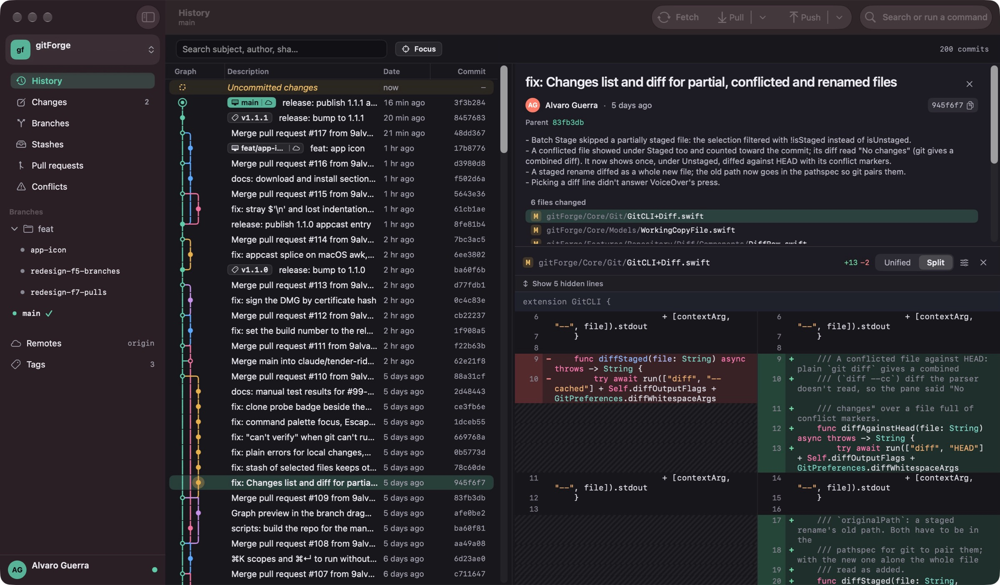
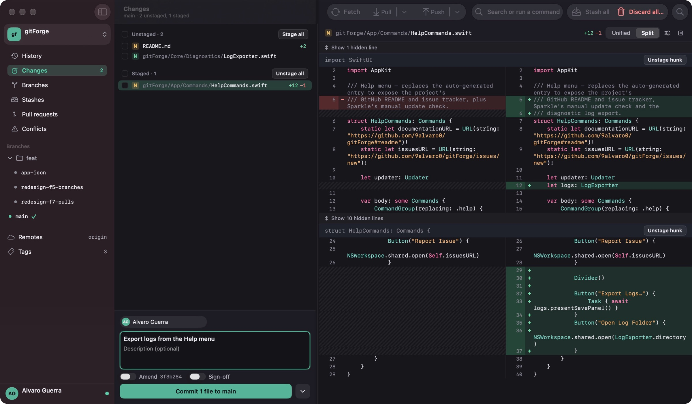
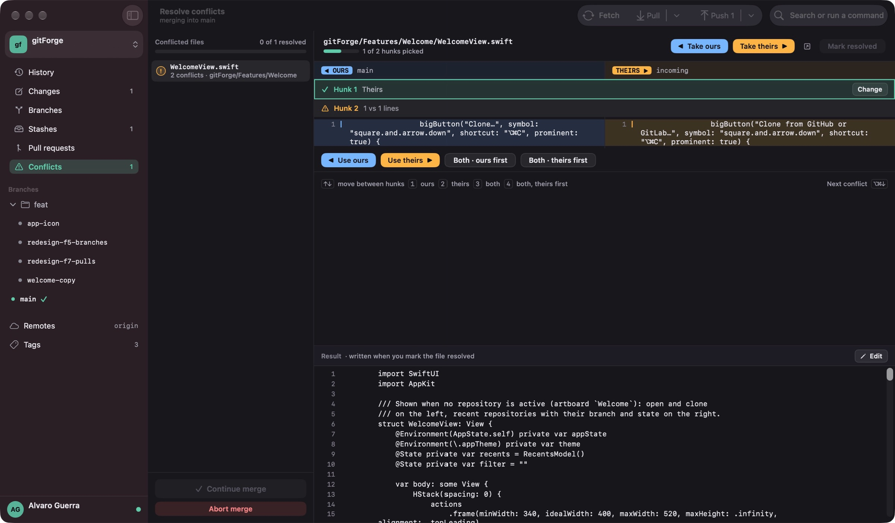
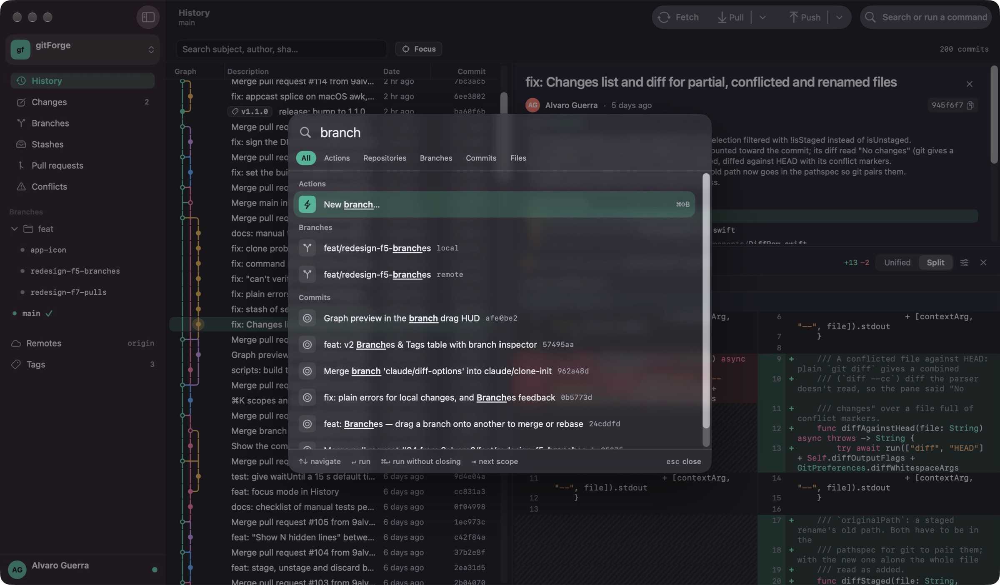

<div align="center">


# gitForge

**A modern, native Git client for macOS, built with SwiftUI.**

Opinionated and focused. Like Fork but native and modern, like GitKraken without the bloat.

[](https://github.com/9alvaro0/gitForge/releases/latest)
[](https://github.com/9alvaro0/gitForge/releases)


[](LICENSE)

[**Download**](https://github.com/9alvaro0/gitForge/releases/latest) · [**Website**](https://9alvaro0.github.io/gitForge/) · [**Release notes**](https://github.com/9alvaro0/gitForge/releases) · [**Roadmap**](https://github.com/9alvaro0/gitForge/issues)

<br>



</div>

<table>
  <tr>
    <td width="33%" align="center" valign="top">
      <br>
      <b>Stage what you mean</b><br>
      <sub>By file, hunk or single line.</sub>
    </td>
    <td width="33%" align="center" valign="top">
      <br>
      <b>Resolve in place</b><br>
      <sub>Merge, rebase, cherry-pick, revert and stash conflicts.</sub>
    </td>
    <td width="33%" align="center" valign="top">
      <br>
      <b>One keystroke away</b><br>
      <sub>Actions, branches, commits and files with <code>⌘K</code>.</sub>
    </td>
  </tr>
</table>

## Download

**[Download the latest version](https://github.com/9alvaro0/gitForge/releases/latest)** (DMG, macOS 26.1 or later, Apple silicon and Intel).

1. Open the DMG and drag **gitForge** to **Applications**.
2. Open it. It is signed and notarized by Apple, so it opens without security warnings.
3. If the Xcode Command Line Tools aren't installed, gitForge offers to install them (they include `git`).

gitForge updates itself: new versions are offered in the app, or from **Help → Check for Updates…**. If you have 1.0.1, download 1.1.0 by hand once; it was the last version without automatic updates.

## Status

In active development. See [Issues](https://github.com/9alvaro0/gitForge/issues) for the roadmap and the [releases](https://github.com/9alvaro0/gitForge/releases) for what's new in each version.

## Features

- **History** — interactive commit graph (branches, tags, stashes as dashed lanes) with a focus mode for one branch's history, commit detail with per-file diffs, unified or side-by-side, syntax highlighted; wrap lines, hide whitespace and expand hidden context lines
- **Changes** — stage / unstage / discard by file, hunk or selected lines; stash by file (with batch selection and a file filter); commit (optionally with sign-off) and amend
- **Branches & tags** — create, checkout, rename, delete, push any local branch, move a branch tip; see which branches are merged and how each compares with `main`; drag a branch onto a commit or another branch to move / merge / rebase; create, push and delete tags
- **Stashes** — stash (optionally with untracked files), apply, pop, drop, browse a stash's files and diffs
- **Conflicts** — visual resolver for merge / rebase / cherry-pick / revert / stash conflicts: pick ours / theirs / both per hunk, or resolve whole files
- **Remotes** — fetch, pull (merge / rebase / fast-forward only), push, force-push with lease, optional background auto-fetch, categorised errors (auth, network, rejected, protected branch…)
- **Pull / merge requests** — read-only list and detail for GitHub and GitLab (including self-hosted), with CI status; integrate a PR locally to resolve its conflicts
- **Clone** — from a URL or by browsing your GitHub / GitLab repositories, optionally shallow or with submodules; or start a new repository
- **Identity profiles** — switch the repo's `user.name` / `user.email` / signing key between saved profiles
- Command palette, native menus and keyboard shortcuts; light / dark themes and accessibility support (VoiceOver, Increase Contrast, Reduce Motion)

Not supported (yet): interactive rebase, LFS, submodule management, creating or reviewing PRs.

## Keyboard Shortcuts

<details>
<summary>Show all shortcuts</summary>

| Shortcut | Action |
| --- | --- |
| `⌘O` | Open Repository… |
| `⌥⌘N` | New Repository… |
| `⇧⌘W` | Close Repository |
| `⌘B` | New Branch… |
| `⌘1` … `⌘4` | Show History / Changes / Branches / Pull Requests |
| `⌘K` | Command palette |
| `⌘F` | Filter history (History tab) |
| `⌘R` | Refresh |
| `⇧⌘F` | Fetch |
| `⇧⌘L` | Pull |
| `⇧⌘P` | Push |
| `⇧⌘C` | Go to the commit composer (Changes) |
| `⌘↩` | Commit (Changes) |
| `⌘,` | Settings |
| `↑` / `↓` | Move through commits (History table focused) |
| `↑` / `↓` | Move through files in any file list (Changes, commit detail, stash, pull request, conflicts) |

</details>

The full action set is also exposed through the native menu bar (File / View / Repository / Help).

## Requirements

- macOS 26.1+
- Xcode 26+ (to build)
- `git` CLI (installed with the Xcode Command Line Tools — the app offers to install them)

## Tech Stack

- SwiftUI + `@Observable`, Swift 6 language mode
- Shell-out to the system `git` CLI via `Process` — no libgit2
- No backend, no telemetry, no analytics
- Distribution: signed and notarized DMG, with Sparkle for auto-updates

## Development

Want to contribute? See [CONTRIBUTING.md](CONTRIBUTING.md).

```bash
open gitForge.xcodeproj
```

Build and run the unit tests from the command line:

```bash
xcodebuild -project gitForge.xcodeproj -scheme gitForge -destination 'platform=macOS' test
```

The suite (Swift Testing) uses real `git` against throwaway repositories in the temp directory; it never touches your repositories or settings. Under XCTest the app launches as an inert test host (no window, no background work).

### Layout

| Path | Contents |
| --- | --- |
| `gitForge/Core/Git` | `GitCLI` (one actor per repository), process spawning (`GitProcess`), output parsers |
| `gitForge/Core/Watchers` | FSEvents-based repository watcher, auto-fetcher |
| `gitForge/Core/RemoteHosting` | GitHub / GitLab API clients, token storage (Keychain), pinned TLS trust |
| `gitForge/Core/Graph` | Commit graph layout engine |
| `gitForge/App` | App entry point, shell, app-wide stores (`AppState`, `RepositoryCatalog`, preferences) |
| `gitForge/Features` | One folder per screen; `Repository/ViewModel` is the per-repository session plus feature stores (`PullRequestStore`, `StashDetailStore`, `ConflictStore`) |
| `gitForge/DesignSystem` | Tokens (spacing, type scale, colours), theme, shared components, icons |
| `audits/BITACORA.md` | Log of the code-quality audits (in Spanish): findings, fixes and open follow-ups |
| `design/` | Original HTML/CSS design prototype (v1 reference) |
| `scripts/` | Release pipeline — see [`scripts/RELEASE.md`](scripts/RELEASE.md) |

## Updates

gitForge ships with [Sparkle](https://sparkle-project.org). New versions are
fetched in the background once a day from
`https://9alvaro0.github.io/gitForge/appcast.xml`. The DMG must pass an EdDSA
signature check against the embedded `SUPublicEDKey` before installation, so
unsigned or tampered builds are rejected even if served from the right URL.

Manual check: **Help → Check for Updates…**

## License

MIT. See [LICENSE](LICENSE).

## Author

Alvaro Guerra Freitas — [@9alvaro0](https://github.com/9alvaro0)
